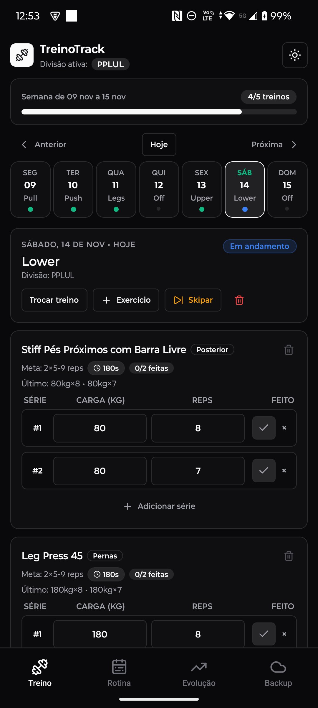
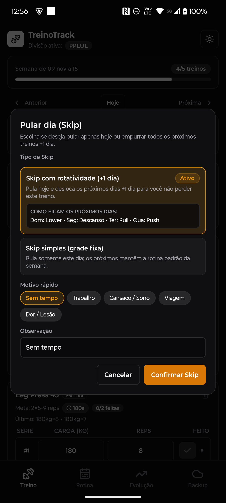
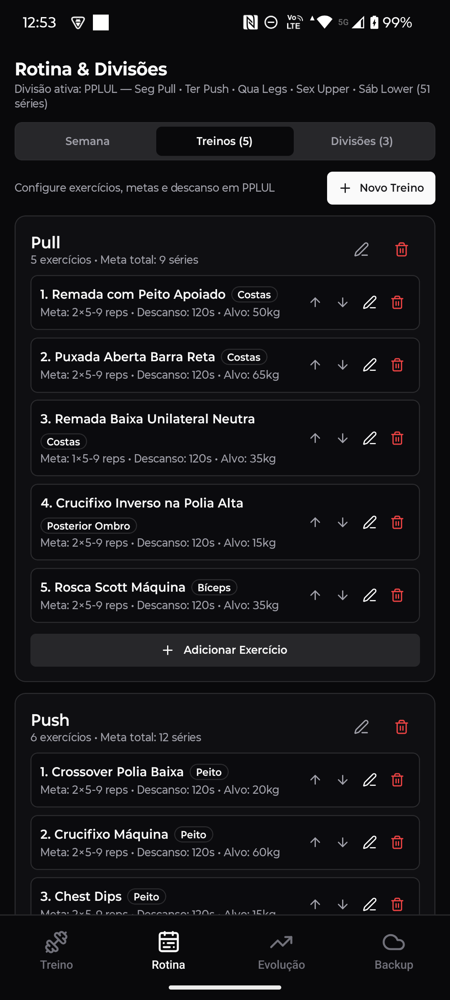
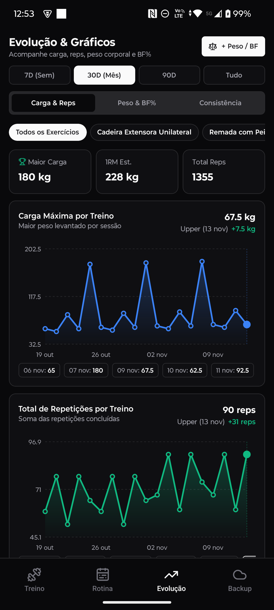
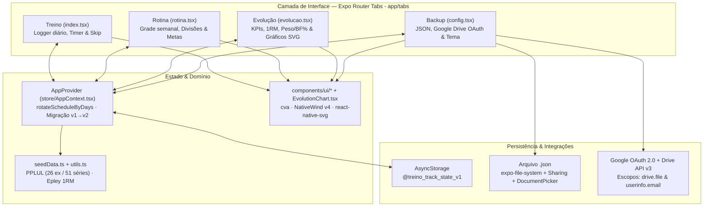

# TreinoTrack

Aplicativo móvel *local-first* para registro diário de treinos de musculação, gestão de rotinas/divisões, **skip com rotatividade (`+1 dia`)**, gráficos SVG de evolução e backup via `.json` ou Google Drive — desenvolvido em **React Native + Expo** com design system inspirado no **shadcn/ui** (temas *Zinc Dark* e *Zinc Light*).

-000020?style=flat-square&logo=expo&logoColor=white)
-61DAFB?style=flat-square&logo=react&logoColor=black)
-3178C6?style=flat-square&logo=typescript&logoColor=white)

-3DDC84?style=flat-square&logo=android&logoColor=black)


---

## Sumário

- [Contexto e Diferenciais](#contexto-e-diferenciais)
- [Vitrine Visual (Screenshots Reais)](#vitrine-visual-screenshots-reais)
- [Funcionalidades e Engenharia Interna](#funcionalidades-e-engenharia-interna)
- [Arquitetura, Segurança e Privacidade](#arquitetura-segurança-e-privacidade)
- [Guia Rápido de Uso](#guia-rápido-de-uso)
- [Guia para Desenvolvedores e Build Reproduzível](#guia-para-desenvolvedores-e-build-reproduzível)
- [Mapa de Documentação e Histórico de Versões](#mapa-de-documentação-e-histórico-de-versões)

---

## Contexto e Diferenciais

### Problema prático resolvido
Planilhas e apps genéricos costumam quebrar em três situações comuns de quem treina seriamente:
1. **Perder um dia na semana sem bagunçar a ordem:** faltar na quarta-feira em um split **PPLUL** não significa pular pernas para sempre — muitas vezes você quer empurrar todos os treinos seguintes `+1 dia` e desfazer facilmente se mudar de plano.
2. **Trocar de divisão sem apagar o passado:** migrar de *Full Body* → *PPLx2* → *PPLUL* mantendo gráficos por exercício, recordes pessoais e histórico de aderência.
3. **Possuir os próprios dados:** manter tudo instantâneo e offline no aparelho, com exportação `.json` legível e backup direto no próprio Google Drive sem depender de servidor intermediário ou assinatura.

### Diferenciais arquiteturais e técnicos
- **Estado local imediato (`AsyncStorage`) com migração automática:** toda mutação atualiza o estado React em memória e persiste em `@treino_track_state_v1`, com upgrade automático da semente demonstrativa `v1 -> v2` preservando tema e credenciais OAuth.
- **UI shadcn/ui em React Native (`components/ui/`):** 10 módulos de interface (`Text`, `Button`, `Card`, `Badge`, `Input`, `Label`, `Tabs`, `Progress`, `Separator`, `Dialog`) construídos com `class-variance-authority` (`cva`), `@rn-primitives/slot`, `tailwind-merge` e variáveis CSS HSL (`global.css`).
- **Gráficos SVG nativos sem biblioteca pesada:** [EvolutionChart.tsx](components/charts/EvolutionChart.tsx) renderiza curvas com gradiente, barras empilhadas (`Feito` vs. `Skip`), cálculo dinâmico de largura via `onLayout` e prevenção de sobreposição de rótulos no eixo X.
- **Rotina PPLUL completa pré-configurada:** 5 dias de treino (`Pull`, `Push`, `Legs`, `Upper`, `Lower`), **26 exercícios** e **51 séries semanais**, com metas de `5-9` reps e tempos individuais de descanso (`120s` padrão; `180s` em compostos pesados).

---

## Vitrine Visual (Screenshots Reais)

Capturas feitas diretamente na build `v1.0.0` instalada via USB em dispositivo físico (`moto g35 5G`, resolução `1080×2400`, modo escuro *Zinc Dark*):

<table>
  <tr>
    <td align="center" width="50%">
      
      <br />
      <sub><strong>1. Treino Diário:</strong> tira semanal Seg–Dom, metas <code>2×5-9</code>, badge de descanso <code>180s</code>, referência da última sessão e inputs de carga/reps.</sub>
    </td>
    <td align="center" width="50%">
      
      <br />
      <sub><strong>2. Skip com Rotatividade (+1 dia):</strong> prévia imediata de como ficam os próximos 4 dias antes de confirmar e motivos rápidos sem truncamento.</sub>
    </td>
  </tr>
  <tr>
    <td align="center" width="50%">
      
      <br />
      <sub><strong>3. Rotina &amp; Divisões:</strong> reordenação (↑/↓), edição de metas/descanso por exercício e resumo automático de volume por treino.</sub>
    </td>
    <td align="center" width="50%">
      
      <br />
      <sub><strong>4. Evolução &amp; Gráficos:</strong> filtros <code>7D</code>/<code>30D</code>/<code>90D</code>/<code>Tudo</code>, KPIs (Maior Carga, 1RM Est., Total Reps), gráficos SVG e seletor horizontal de pontos.</sub>
    </td>
  </tr>
</table>

---

## Funcionalidades e Engenharia Interna

### 1. Gerenciamento de Estado, Persistência e Tema ([store/AppContext.tsx](store/AppContext.tsx))
- **Modelo central (`AppDataState` em [types/workout.ts](types/workout.ts)):** armazena `version: 2`, `themePreference`, `isDemoSeeded`, `splits[]`, `logs[]`, `bodyMetrics[]` e `backupConfig`.
- **Persistência síncrona na UI / assíncrona em disco:** `updateState` aplica o *updater* funcional imediatamente no React state e grava em `AsyncStorage` (`STORAGE_KEY = '@treino_track_state_v1'`) em segundo plano com captura de erro via `console.warn`.
- **Migração `v1 -> v2`:** na inicialização, se encontrar estado persistido com `(parsed.version ?? 1) < 2` e `parsed.isDemoSeeded === true`, recarrega o catálogo demo `v2` (com a rotina PPLUL de 26 exercícios / 51 séries) preservando `themePreference` e `backupConfig`. Se `isDemoSeeded === false` (dados reais do usuário), mantém os dados intactos.
- **Sincronização de tema em múltiplas camadas:** `toggleTheme` alterna entre `'dark'` e `'light'`, atualiza NativeWind (`setColorScheme`), chama `Appearance.setColorScheme` (quando suportado pela plataforma) e injeta a classe `'dark'` em [RootLayoutNav](app/_layout.tsx) e diretamente via `useAppStore()` em [Dialog](components/ui/dialog.tsx), [TabLayout](app/%28tabs%29/_layout.tsx) e [EvolutionChart](components/charts/EvolutionChart.tsx).

### 2. Skip com Rotatividade Reversível e Grade Semanal ([store/AppContext.tsx](store/AppContext.tsx) & [app/(tabs)/index.tsx](app/%28tabs%29/index.tsx))
- **Aritmética modular da rotação (`rotateScheduleByDays`):**
  ```ts
  const target = ((d + delta + 7) % 7) as WeekdayIndex;
  next[target] = schedule[d] ?? null;
  ```
  Desloca todos os 7 dias da semana (`0 = Dom` a `6 = Sáb`) para frente (`delta = 1`) ou para trás (`delta = -1`), preservando dias de descanso (`null`).
- **Proteção contra dupla rotação e troca de modo (`skipDay`):**
  - Se o dia já estava `skipped` com `skipMode: 'rotate'` e o usuário confirmar novamente em modo `'rotate'`, `shouldRotateForward` permanece `false` (não gira `+2` dias por engano).
  - Se estava em `'rotate'` e o usuário reconfirmar em modo `'simple'`, `shouldRevertRotation` aplica `rotateScheduleByDays(..., -1)` antes de salvar como `'simple'`.
- **Reversão limpa (`unskipDay`):** remove o `WorkoutLog` da data e, caso `existing.skipMode === 'rotate'`, desfaz automaticamente o deslocamento (`delta = -1`).
- **Prévia antes da confirmação (`rotationPreview`):** no diálogo de Skip, exibe o impacto projetado nos próximos 4 dias (`offset` `1..4`) antes do usuário confirmar.
- **Rotação manual na rotina:** na aba **Rotina → Semana**, os botões **Voltar -1 dia** e **Empurrar +1 dia** chamam `rotateActiveSchedule(-1 | 1)` para ajustes livres.

### 3. Execução de Treino, Metas e Cronômetro de Descanso ([app/(tabs)/index.tsx](app/%28tabs%29/index.tsx))
- **Pré-preenchimento inteligente (`startOrSwitchWorkoutForDate`):** ao iniciar um treino planejado ou trocado, busca a última sessão com `status === 'completed'` anterior à `dateISO` para cada exercício (`getLastExerciseLog`, comparação case-insensitive via `exerciseName.trim().toLowerCase()`) e preenche `weightKg` e `reps` série a série. Se não houver histórico, usa `targetWeightKg` (ou `0`) e o limite inferior de `targetReps` (`parseInt(targetReps.split(/[-–]/)[0] || '5', 10)`).
- **Avaliação de metas (`parseRepsRange` em [lib/utils.ts](lib/utils.ts)):** interpreta strings no formato `5-9`, `5–9`, `5a9` ou número único; quando todas as `targetSets` estão concluídas e com repetições `>= min`, exibe o badge `Meta batida!`.
- **Cronômetro regressivo integrado:** marcar qualquer série como concluída (`completed: true`) ou tocar no badge de descanso (`120s` / `180s`) inicia contagem regressiva de `1000ms` via `setInterval` (com cleanup no `useEffect`), oferecendo botão `+15s` e fechamento manual.
- **Conclusão tolerante (`setWorkoutStatus`):** ao tocar em **Concluir e Salvar Treino**, séries com `reps > 0` de exercícios que não tiveram check manual são automaticamente marcadas como `completed: true`.
- **Flexibilidade intra-treino:** permite trocar o template do dia, iniciar **Treino Avulso**, adicionar/remover exercícios ad-hoc e adicionar/remover séries com renumeração sequencial (`setNumber`).

<details>
<summary><strong>Detalhamento completo da rotina PPLUL padrão em lib/seedData.ts (26 exercícios · 51 séries)</strong></summary>

| Dia | Treino | Exercícios | Séries | Regras de Meta &amp; Descanso |
| --- | --- | :---: | :---: | --- |
| Segunda | `Pull` | 5 | 9 | `2×5-9` (`120s`), exceto `Remada Baixa Unilateral Neutra` (**1 série**) |
| Terça | `Push` | 6 | 12 | `2×5-9` (`120s`) em todos os 6 exercícios |
| Quarta | `Legs` | 4 | 8 | `2×5-9` (`120s`), exceto `Agachamento Pêndulo` (**180s**) |
| Quinta | *Descanso* | — | — | Recuperação (`null` na grade) |
| Sexta | `Upper` | 6 | 12 | `2×5-9` (`120s`) em todos os 6 exercícios |
| Sábado | `Lower` | 5 | 10 | `2×5-9` (`120s`), exceto `Stiff Pés Próximos com Barra Livre` e `Leg Press 45` (**180s**) |
| Domingo | *Descanso* | — | — | Recuperação (`null` na grade) |
| **Total** | **5 sessões** | **26** | **51** | Presets extras inclusos: `PPLx2`, `Full Body`, `Upper / Lower`, `Personalizada` |

</details>

### 4. Gráficos SVG, Fórmulas e Filtragem ([app/(tabs)/evolucao.tsx](app/%28tabs%29/evolucao.tsx) & [components/charts/EvolutionChart.tsx](components/charts/EvolutionChart.tsx))
- **Janelas temporais:** `7D (Sem)`, `30D (Mês)`, `90D` e `Tudo`, aplicáveis simultaneamente a sessões concluídas, medições corporais e aderência semanal.
- **Métricas calculadas:**
  - **1RM estimado (Epley em `estimate1RM`):** retorna `weightKg` quando `reps === 1`, ou `Math.round(weightKg * (1 + reps / 30) * 10) / 10` (0 quando peso ou reps `<= 0`).
  - **Volume da sessão / exercício:** $\sum (\text{reps} \times \text{weightKg})$ considerando apenas séries marcadas como `completed`.
  - **Massa magra estimada:** `Math.round(weightKg * (1 - bodyFatPct / 100) * 10) / 10`.
  - **Aderência (%):** `Math.round((totalDone / (totalDone + totalSkipped)) * 100)` (`100%` quando não há registros).
- **Renderização resiliente de gráficos:**
  - `EvolutionLineChart`: adiciona folga vertical automática (`spread === 0 ? Math.max(1, rawMax * 0.1) : spread * 0.18`) com piso `>= 0`, oculta o rótulo do penúltimo/último ponto se estiverem muito próximos (`lastTooClose`) e disponibiliza faixa horizontal rolável com os últimos 6 pontos para inspeção precisa por toque.
  - `ConsistencyBarChart`: agrupa treinos concluídos e skipados por segunda-feira (`getMondayOfWeekISO`), limita o histograma às últimas 8 semanas (`slice(-8)`) e alterna rótulos no eixo X quando `slotW < 42`.
- **Upsert de medições corporais (`upsertBodyMetric`):** substitui eventual entrada pré-existente na mesma data (`m.date !== entry.date`) e mantém `bodyMetrics` sempre ordenado cronologicamente.

### 5. Backup Multiplataforma e Google Drive ([lib/backupService.ts](lib/backupService.ts) & [app/(tabs)/config.tsx](app/%28tabs%29/config.tsx))
- **Formato padronizado (`BackupEnvelope`):** encapsula `{ app: 'TreinoTrack', schemaVersion: 1, exportedAt, data }`. `parseBackupPayload` valida a presença dos arrays `splits`, `logs` e `bodyMetrics` e aceita tanto envelopes versionados quanto objetos `AppDataState` puros.
- **Exportação / Importação local (`.json`):**
  - **Android/iOS:** escreve `treino-track-backup.json` em `Paths.cache` usando a API moderna `File` / `Paths` (`expo-file-system`) e abre a folha nativa de compartilhamento (`expo-sharing`, `mimeType: 'application/json'`). A importação usa `expo-document-picker` com leitura via `File(asset.uri).text()`.
  - **Web:** gera `Blob` + `<a download="treino-track-backup-YYYY-MM-DD.json">` para exportar e lê via `asset.file.text()` (ou `fetch(asset.uri)`) para importar.
- **Sincronização com Google Drive API v3:**
  - Autenticação OAuth 2.0 via `expo-auth-session/providers/google` + `expo-web-browser` usando o Client ID configurado pelo próprio usuário na interface.
  - Busca arquivo existente com `q = "name = 'treino-track-backup.json' and trashed = false"` em `spaces=drive`; envia payload via `multipart/related` usando `PATCH` (se já existir) ou `POST` (se for o primeiro envio) e restaura com `GET ...?alt=media`.

### 6. Escopo Real e Transparência sobre Pistas Arquiteturais
Para manter 100% de fidelidade ao código implementado:
- **Execução 100% local no cliente:** não há servidor backend, daemon em segundo plano, *WorkManager* periódico, fila de IPC nativa personalizada nem telemetria/coleta de sensores de hardware.
- **Resiliência de interface específica para Android Fabric (RN `0.88.1`):**
  - `Input` aplica `textAlignVertical="center"`, `paddingVertical: 0` e `includeFontPadding: false` com `h-11` para impedir corte vertical em campos numéricos pequenos.
  - `TabLayout` usa `useSafeAreaInsets()` (`height: 58 + Math.max(insets.bottom, 10)`) para respeitar a barra de gestos sem sobreposição.
  - Labels críticos em `Button` e tiras flex (`+ Adicionar Exercício`, nomes da tira de 7 dias) usam `numberOfLines={1}` + `adjustsFontSizeToFit` para evitar quebra ou truncamento em cálculos de largura do Yoga/Fabric.

---

## Arquitetura, Segurança e Privacidade

### Visão Arquitetural



### Permissões do Manifesto Android (`android/app/src/main/AndroidManifest.xml`, gerado pelo prebuild)

| Permissão / Declaração | Escopo / Restrição | Finalidade Real no App |
| --- | --- | --- |
| `android.permission.INTERNET` | Padrão | Autenticação Google OAuth (`expo-auth-session`), requisições à Google Drive API v3 / Userinfo e conexão com Metro em desenvolvimento. |
| `android.permission.VIBRATE` | Padrão | Feedback tátil de sistema/componentes nativos suportados pelo runtime React Native / Expo. |
| `android.permission.READ_EXTERNAL_STORAGE` | `maxSdkVersion="32"` | Compatibilidade de leitura ao importar arquivos `.json` de backup em Android 12L (API 32) ou inferior. |
| `android.permission.WRITE_EXTERNAL_STORAGE` | `maxSdkVersion="32"` | Compatibilidade de gravação/compartilhamento de backup em Android 12L (API 32) ou inferior. |
| `android.permission.SYSTEM_ALERT_WINDOW` | Template prebuild (e manifests `debug` / `debugOptimized`) | Exibição de overlay do React Native/Expo em builds de desenvolvimento; não é solicitada nem usada em fluxos de produção do app. |
| `<queries>` (`VIEW` + `BROWSABLE` + `https`) | Padrão | Permitir abertura de navegador/Custom Tabs para o fluxo OAuth 2.0 do Google (`expo-web-browser`). |
| `intent-filter` `scheme="treinotrack"` | `MainActivity` (`portrait`, `singleTask`) | Receber o retorno (deep link) do fluxo de autenticação OAuth. |
| `android:allowBackup="true"` | `<application>` | Configuração padrão gerada pelo `expo prebuild` para backup automático de dados do aplicativo no Android. |

> [!NOTE]
> Nos manifests auxiliares `android/app/src/debug/AndroidManifest.xml` e `android/app/src/debugOptimized/AndroidManifest.xml`, `android:usesCleartextTraffic="true"` é habilitado exclusivamente para o servidor de desenvolvimento Metro; o manifest `main` de release não habilita tráfego HTTP em texto claro.

### Garantias e Não-Objetivos
- **Escopo mínimo no Google Drive:** solicita apenas `https://www.googleapis.com/auth/drive.file` e `userinfo.email` — o aplicativo só acessa o arquivo `treino-track-backup.json` criado por ele mesmo, nunca outros arquivos do Drive.
- **Sem segredos embutidos no repositório:** nenhum `client_secret`, token ou `googleClientId` vem hardcoded; cada usuário insere seu próprio Client ID em **Backup → Client ID** (salvo apenas localmente em `AsyncStorage`).
- **Armazenamento sem criptografia adicional no aparelho:** os dados de treino, medições corporais e Client IDs são persistidos em JSON simples no `AsyncStorage` privado do app no sistema operacional.
- **Assinatura atual de build:** o bloco `release` em `android/app/build.gradle` aponta atualmente para `signingConfigs.debug` para facilitar instalação local via USB/sideload; **não** utilize essa assinatura em publicação na Play Store sem substituir por uma keystore de release privada.

---

## Guia Rápido de Uso

### Instalação direta no Android (APK `v1.0.0`)
1. Baixe `treino-track-v1.0.0.apk` na página de [Releases do GitHub](https://github.com/gustavolafz/treino-track/releases/tag/v1.0.0) (ou via USB com `adb install -r treino-track-v1.0.0.apk`).
2. Ao abrir pela primeira vez, o app traz dados de exemplo (`PPLUL`, histórico recente e 6 medições corporais) para você explorar os gráficos.
3. Para iniciar com seus registros limpos mantendo sua divisão **PPLUL** intacta, acesse a aba **Backup → Zerar Dados**.

### Fluxo diário seguro
- **Treinar:** na aba **Treino**, toque em **Registrar Treino**, ajuste `Carga (kg)` e `Reps`, marque ✓ nas séries concluídas (dispara o descanso automaticamente) e finalize em **Concluir e Salvar Treino**.
- **Pular dia com rotatividade:** toque em **Pular Dia** (ou **Skipar**), mantenha **Skip com rotatividade (+1 dia)** selecionado, confira a prévia dos próximos 4 dias e confirme. Caso volte atrás, toque em **Desfazer Skip e Rotação**.
- **Backup no Google Drive (opcional):** no Google Cloud Console, ative a **Google Drive API**, crie um OAuth 2.0 Client ID (Web / Android) com escopo `drive.file`, toque em **Client ID** na aba **Backup**, cole o identificador e clique em **Conectar com Google**.

---

## Guia para Desenvolvedores e Build Reproduzível

### Toolchain e dependências verificadas

| Componente | Versão / Valor no Repositório | Arquivo de Referência |
| --- | --- | --- |
| Expo SDK / Router | `~58.0.25` / `~58.0.31` | [package.json](package.json) |
| React / React Native | `19.3.0` / `0.88.1` (`newArchEnabled=true`, `hermesEnabled=true`) | [package.json](package.json), `android/gradle.properties` |
| Estilização & UI | `nativewind ^4.2.7`, `tailwindcss ^3.4.19`, `lucide-react-native ^1.73.0`, `react-native-svg 15.16.0` | [package.json](package.json), [tailwind.config.js](tailwind.config.js) |
| Persistência & Arquivos | `@react-native-async-storage/async-storage 2.2.0`, `expo-file-system ~58.0.13`, `expo-sharing ~58.0.23`, `expo-document-picker ~58.0.5` | [package.json](package.json) |
| Linguagem & Lint | `typescript ~6.0.3` (`strict: true`), `eslint ^9.0.0`, `eslint-config-expo ~58.0.4` | [tsconfig.json](tsconfig.json), [eslint.config.js](eslint.config.js) |
| Build Android | Gradle `9.4.1`, OpenJDK `21.0.13`, Platform `android-37.0`, Build-Tools `36.0.0`/`37.0.0`, NDK `27.1.12297006`, R8 ativo (`android.enableMinifyInReleaseBuilds=true`) | `android/gradle/wrapper/gradle-wrapper.properties`, `android/gradle.properties` |
| Node.js | Compilado e verificado com `v20.19.0` (Expo CLI emite aviso recomendando `>=22.13.0`) | Saída de CLI / build |
| Licença base | MIT (`Copyright (c) 2015-present 650 Industries, Inc.`) | [LICENSE](LICENSE) |

### Instalação de pacotes e convenções do projeto
- **Adição de pacotes:** use sempre `npx expo install <pacote>` para garantir compatibilidade com o Expo SDK 58 (conforme [AGENTS.md](AGENTS.md)).
- **Roteamento:** as telas ficam em [app/](app/) via Expo Router (`typedRoutes: true` em [app.json](app.json)); utilitários, tipos, estado e componentes ficam fora de `app/`.
- **Atalho de path:** `@/*` mapeia para a raiz do projeto em [tsconfig.json](tsconfig.json).
- **Pastas nativas geradas:** `android/` e `ios/` estão no [.gitignore](.gitignore) (CNG via `npx expo prebuild`); prefira configurar comportamento nativo em [app.json](app.json).

### Comandos de desenvolvimento, build e verificação

```bash
# 1. Instalar dependências
npm install

# 2. Subir servidor de desenvolvimento Expo
npx expo start

# 3. Verificações estáticas (TypeScript strict + ESLint Flat Config)
npx tsc --noEmit
npx expo lint

# 4. Prebuild nativo Android e build Release para arm64-v8a
npx expo prebuild --platform android
cd android && ./gradlew assembleRelease -PreactNativeArchitectures=arm64-v8a

# 5. Instalar APK no aparelho via USB e abrir a MainActivity
adb install -r android/app/build/outputs/apk/release/app-release.apk
adb shell am start -n com.treinotrack.app/.MainActivity
```

### Estado real dos testes e validações
- **Checagem estática e lint executados:** `npx tsc --noEmit` (`strict: true`, 0 erros) e `npx expo lint` (`eslint-config-expo/flat`, 0 erros/avisos).
- **Validação em dispositivo real:** build `release` (`arm64-v8a`, `33.23 MiB`) compilada com `./gradlew assembleRelease -PreactNativeArchitectures=arm64-v8a` (`BUILD SUCCESSFUL in 43s`), instalada via ADB e auditada visualmente por capturas de tela em `moto g35 5G` (Android) nos modos claro e escuro.
- **Limitação explícita:** o repositório **não possui** suíte de testes unitários ou E2E automatizada (Jest, Vitest ou Detox) configurada em [package.json](package.json) até esta versão `v1.0.0`.

---

## Mapa de Documentação e Histórico de Versões

| Documento | Conteúdo | Link |
| --- | --- | --- |
| **Notas da Release `v1.0.0`** | Escopo completo, rotinas, correções visuais, SHA-256 e ressalvas da build | [docs/releases/v1.0.0.md](docs/releases/v1.0.0.md) |
| **Arquivo Histórico** | Registro da migração do template Expo e histórico das iterações visuais `v1 -> v3` | [docs/archive/README.md](docs/archive/README.md) |
| **Capturas de Tela (`v1.0.0`)** | 4 screenshots oficiais do dispositivo usados na vitrine | [docs/images/](docs/images/) |
| **Guia para Agentes** | Regras de workflow Expo SDK, `npx expo install` e verificações | [AGENTS.md](AGENTS.md) / [CLAUDE.md](CLAUDE.md) |
| **Licença** | Texto integral da Licença MIT | [LICENSE](LICENSE) |

### Histórico compacto de versões

| Versão | Status | Resumo | Notas |
| --- | --- | --- | --- |
| `v1.0.0` | Atual / Publicada no GitHub | MVP completo com rotina PPLUL (26 ex / 51 séries), skip com rotatividade `+1 dia`, timer, gráficos SVG, JSON + Google Drive e APK `arm64-v8a` | [v1.0.0](docs/releases/v1.0.0.md) |
